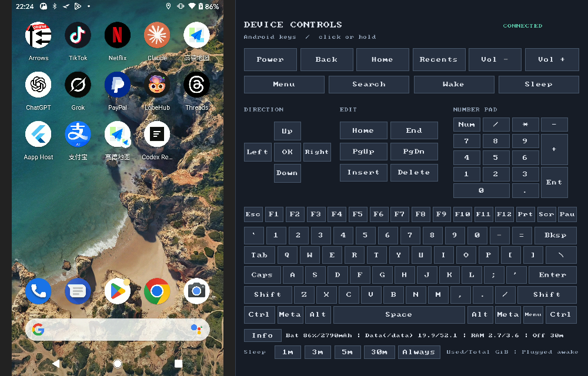

<!-- Modified by moasm in 2026 for scrcpy-controls. -->
# scrcpy-controls

**English** | [简体中文](README.zh-CN.md)

[](https://github.com/django798/scrcpy-controls/actions/workflows/control-panel.yml)

An unofficial fork of [Genymobile/scrcpy](https://github.com/Genymobile/scrcpy),
based on **v5.0.1**, with an integrated keyboard and Android control panel.
Maintained by moasm <moasm@sina.com> under Apache-2.0.

## Runtime screenshot



Captured from **5.0.1-controls.2** on Windows, mirroring a **Pixel 2 (Android 11)**.
The two bottom rows show the persistent **`Used/Total GiB`** legend and the
explicit `Data(/data)` label. Readings are snapshots, populated at startup
and refreshed with **Info**.

## Features

- **Integrated controls:** full PC keyboard, Power, Back, Home, Recents, volume,
  D-pad, navigation keys, modifiers and key repeat. Enabled by default;
  `--no-control-panel` hides the panel.
- **Multiple devices:** start once to open one window per online authorized ADB
  device. Use `-s SERIAL` to select one. Windows listeners and ADB forwards are
  isolated between instances.
- **Compact device settings:** battery percentage and capacity when exposed by
  the device, data storage, RAM, and screen timeout. Presets: 1, 3, 5, 30 minutes
  or Always. A preset is highlighted only after the setting is read back.

## Windows: download and run

1. Download and extract the official
   [scrcpy-win64-v5.0.1.zip](https://github.com/Genymobile/scrcpy/releases/download/v5.0.1/scrcpy-win64-v5.0.1.zip).
2. Download the Windows x64 **client overlay** from
   [this fork's latest release](https://github.com/django798/scrcpy-controls/releases/latest).
   Extract it into the same directory, replacing `scrcpy.exe`.
3. Enable USB debugging, authorize the computer on Android, and run
   `run-controls.bat`.

```bat
run-controls.bat
run-controls.bat -s DEVICE_SERIAL --no-audio
run-controls.bat --no-control-panel
```

The overlay contains the modified client and documentation. ADB, runtime DLLs
and the Android server come from the matching official **v5.0.1** package.
See the [installation guide](doc/windows-overlay.md).

## Reading the device information

The second row always displays **`Used/Total GiB`**. For example,
`Data(/data) 19.9/52.1` and `RAM 2.7/3.6` mean 19.9 GiB of storage used out of
52.1 GiB, and 2.7 GiB of RAM used out of 3.6 GiB. Neither numerator means free.

| Field | Source and meaning |
| --- | --- |
| `Data(/data)` | Used / total filesystem blocks reported by `df -k /data`. This is the data filesystem, including app data and user files backed by it. |
| `RAM` | `(MemTotal - MemAvailable) / MemTotal` from `/proc/meminfo`. Reclaimable memory is treated as available; this is not the sum of process RSS. |
| Whole internal flash, often called ROM | A separate hardware/storage-media capacity covering data, system and boot partitions. It is not inferred from `/data` and is not displayed by this panel. |

GiB means 2³⁰ bytes; it is different from the decimal GB used in advertised
storage sizes. Filesystem reserves and quotas can also affect allocatable
space. Free space inside a system partition is not additional space for apps.
Android's [StorageStatsManager](https://developer.android.com/reference/android/app/usage/StorageStatsManager)
also distinguishes the display capacity of the storage media from free space on
a volume, which may include reclaimable cache. Those values need not match `df`.

Click **Info** to refresh. Missing values show `--`. Battery mAh is shown only
when the device exposes a full/design capacity, never inferred from charge left.

Timeout presets persist after exit. **Always** uses `2147483647 ms` and keeps the
screen awake on external power; vendor policies and manual screen-off still
apply. Selecting a finite preset disables stay-awake while plugged in. Upstream
`--stay-awake` / `--screen-off-timeout` exit-restoration behavior still applies
when those options are explicitly supplied.

## Build from source

Windows, with Python 3 and PowerShell:

```powershell
powershell -ExecutionPolicy Bypass -File .\tools\build-windows.ps1
powershell -ExecutionPolicy Bypass -File .\tools\build-windows.ps1 -Configuration release
```

Tools and verified dependencies are kept under ignored local build directories.
The resulting complete local runtime is in `dist/scrcpy-controls-windows-x64`.
Public releases use the client-only overlay described above.

Linux and macOS: install the dependencies in the upstream
[build guide](doc/build.md), including SDL3, FFmpeg, libusb, Meson and Ninja.

```sh
meson setup build-controls --buildtype=debug -Dcompile_server=false
meson compile -C build-controls
meson test -C build-controls --print-errorlogs
curl -fL https://github.com/Genymobile/scrcpy/releases/download/v5.0.1/scrcpy-server-v5.0.1 -o scrcpy-server
SCRCPY_SERVER_PATH="$PWD/scrcpy-server" SCRCPY_ICON_DIR="$PWD/app/data" \
  ./build-controls/app/scrcpy
```

The server SHA-256 is
`764eb6f79811d5211fe9df341120882ba9994c7a61b897d7bf3fb662e53bc536`.
Windows has been tested with real Android devices. Native CI builds and runs
17 automated tests on Linux, macOS Intel and Apple Silicon; physical-device
interaction on Linux/macOS remains unverified. See [Actions](https://github.com/django798/scrcpy-controls/actions/workflows/control-panel.yml).

## Documentation and support

- [Changes from upstream](MODIFICATIONS.md)
- [Fork issues](https://github.com/django798/scrcpy-controls/issues)
- Upstream: [connection](doc/connection.md), [video](doc/video.md),
  [audio](doc/audio.md), [control](doc/control.md), [shortcuts](doc/shortcuts.md),
  [FAQ](FAQ.md). Upstream installation packages do not include this fork's panel.
- [Support the upstream maintainer, rom1v](https://github.com/sponsors/rom1v)

## License

[Apache-2.0](LICENSE). See [NOTICE](NOTICE) and
[third-party licenses and distribution](THIRD_PARTY_NOTICES.md).
This independent repository imports clean version snapshots and preserves
upstream attribution and license notices. It is not endorsed by Genymobile or rom1v.

Copyright (C) 2018 Genymobile. Copyright (C) 2018–2026 Romain Vimont.
Copyright (C) 2026 moasm, for the scrcpy-controls modifications.
