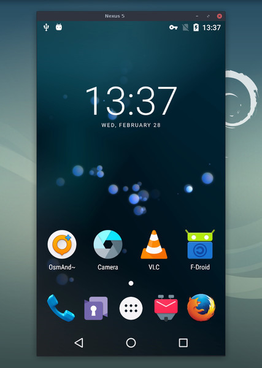

<!-- Modified by moasm in 2026 for scrcpy-controls. -->
# scrcpy-controls

[](https://github.com/django798/scrcpy-controls/actions/workflows/control-panel.yml)

**非官方 scrcpy 扩展版 / Unofficial fork of
[Genymobile/scrcpy](https://github.com/Genymobile/scrcpy), based on v5.0.1.**
Maintained by moasm <moasm@sina.com>, under Apache-2.0.
The original project's copyright notices and license are preserved.

- **右侧全键盘和 Android 按键**：Power、返回、Home、多任务、音量、方向键等，
  与投屏位于同一窗口。默认显示，可用 `--no-control-panel` 隐藏。
- **多设备同时投屏**：直接启动，为所有在线且已授权的 ADB 设备分别打开窗口；
  `-s SERIAL` 仍可只选择一台。修复 Windows 多实例端口冲突。
- **两排快捷设置**：读取电量、可用的电池容量、存储和内存，设置熄屏超时
  1/3/5/30 分钟或常亮，读回确认后显示设置结果。

Windows 下载 [客户端覆盖包](https://github.com/django798/scrcpy-controls/releases/latest)，
解压到**上游官方 v5.0.1 Windows x64 完整包**目录，覆盖 `scrcpy.exe`，
然后运行 `run-controls.bat`。覆盖包不包含 ADB、运行库或 Android 服务端。
详见 [运行、构建和功能说明](doc/control-panel.md)、[变更记录](MODIFICATIONS.md)
及 [第三方许可](THIRD_PARTY_NOTICES.md)。

The panel includes a full PC keyboard, Android navigation keys and compact device
settings. Multiple connected devices open in separate windows automatically.
Windows binaries are supplied as a client-only overlay for the matching official
v5.0.1 package. Linux and macOS users can [build from source](doc/control-panel.md#linux--macos).
CI builds and tests Linux, macOS Intel and Apple Silicon; device interaction on
macOS/Linux still needs hardware validation.

The documentation below is inherited from upstream. Upstream installation links
install the original scrcpy without this fork's panel. For fork-specific issues,
use [this repository's issue tracker](https://github.com/django798/scrcpy-controls/issues).

## Upstream scrcpy (v5.0.1)

The official upstream project is <https://github.com/Genymobile/scrcpy>.


_pronounced "**scr**een **c**o**py**"_

This application mirrors Android devices (video and audio) connected via USB or
[TCP/IP](doc/connection.md#tcpip-wireless) and allows control using the
computer's keyboard and mouse. It does not require _root_ access or an app
installed on the device. It works on _Linux_, _Windows_, and _macOS_.

[](doc/linux.md)&nbsp;
[](doc/windows.md)&nbsp;
[](doc/macos.md)&nbsp;



It focuses on:

 - **lightness**: native rendering, with an optional control panel in this fork
 - **performance**: 30~120fps, depending on the device
 - **quality**: 1920×1080 or above
 - **low latency**: [35~70ms][lowlatency]
 - **low startup time**: ~1 second to display the first image
 - **non-intrusiveness**: nothing is left installed on the Android device
 - **user benefits**: no account, no ads, no internet required
 - **freedom**: free and open source software

[lowlatency]: https://github.com/Genymobile/scrcpy/pull/646

Its features include:
 - [audio forwarding](doc/audio.md) (Android 11+)
 - [recording](doc/recording.md)
 - [virtual display](doc/virtual-display.md)
 - mirroring with [Android device screen off](doc/device.md#turn-screen-off)
 - [copy-paste](doc/control.md#copy-paste) in both directions
 - [configurable quality](doc/video.md)
 - [camera mirroring](doc/camera.md) (Android 12+)
 - [mirroring as a webcam (V4L2)](doc/v4l2.md) (Linux-only)
 - physical [keyboard][hid-keyboard] and [mouse][hid-mouse] simulation (HID)
 - [gamepad](doc/gamepad.md) support
 - [OTG mode](doc/otg.md)
 - and more…

[hid-keyboard]: doc/keyboard.md#physical-keyboard-simulation
[hid-mouse]: doc/mouse.md#physical-mouse-simulation

## Prerequisites

The Android device requires at least API 21 (Android 5.0).

[Audio forwarding](doc/audio.md) is supported for API >= 30 (Android 11+).

Make sure you [enabled USB debugging][enable-adb] on your device(s).

[enable-adb]: https://developer.android.com/studio/debug/dev-options#enable

On some devices (especially Xiaomi), you might get the following error:

```
Injecting input events requires the caller (or the source of the instrumentation, if any) to have the INJECT_EVENTS permission.
```

In that case, you need to enable [an additional option][control] `USB debugging
(Security Settings)` (this is an item different from `USB debugging`) to control
it using a keyboard and mouse. Rebooting the device is necessary once this
option is set.

[control]: https://github.com/Genymobile/scrcpy/issues/70#issuecomment-373286323

Note that USB debugging is not required to run scrcpy in [OTG mode](doc/otg.md).


## Get the app

 - [Linux](doc/linux.md)
 - [Windows](doc/windows.md) (read [how to run](doc/windows.md#run))
 - [macOS](doc/macos.md)


## Must-know tips

 - [Reducing resolution](doc/video.md#size) may greatly improve performance
   (`scrcpy -m1024`)
 - [_Right-click_](doc/mouse.md#mouse-bindings) triggers `BACK`
 - [_Middle-click_](doc/mouse.md#mouse-bindings) triggers `HOME`
 - <kbd>Alt</kbd>+<kbd>f</kbd> toggles [fullscreen](doc/window.md#fullscreen)
 - There are many other [shortcuts](doc/shortcuts.md)


## Usage examples

There are a lot of options, [documented](#user-documentation) in separate pages.
Here are just some common examples.

 - Capture the screen in H.265 (better quality), limit the size to 1920, limit
   the frame rate to 60fps, disable audio, and control the device by simulating
   a physical keyboard:

    ```bash
    scrcpy --video-codec=h265 --max-size=1920 --max-fps=60 --no-audio --keyboard=uhid
    scrcpy --video-codec=h265 -m1920 --max-fps=60 --no-audio -K  # short version
    ```

 - Start VLC in a new virtual display (separate from the device display):

    ```bash
    scrcpy --new-display=1920x1080 --start-app=org.videolan.vlc
    ```

 - Start VLC in a new _flex_ display using H.265 with a bitrate of 16 Mbps,
   while keeping the display active so it does not turn off:

    ```bash
    scrcpy --new-display -x --keep-active --start-app=org.videolan.vlc --video-codec=h265 -b16M
    ```

 - Record the device camera in H.265 at 1920x1080 (and microphone) to an MP4
   file:

    ```bash
    scrcpy --video-source=camera --video-codec=h265 --camera-size=1920x1080 --record=file.mp4
    ```

 - Capture the device front camera and expose it as a webcam on the computer (on
   Linux):

    ```bash
    scrcpy --video-source=camera --camera-size=1920x1080 --camera-facing=front --v4l2-sink=/dev/video2 --no-playback
    ```

 - Control the device without mirroring by simulating a physical keyboard and
   mouse (USB debugging not required):

    ```bash
    scrcpy --otg
    ```

 - Control the device using gamepads plugged into the computer:

    ```bash
    scrcpy --gamepad=uhid
    scrcpy -G  # short version
    ```

## User documentation

The application provides a lot of features and configuration options. They are
documented in the following pages:

 - [Connection](doc/connection.md)
 - [Video](doc/video.md)
 - [Audio](doc/audio.md)
 - [Control](doc/control.md)
 - [Keyboard](doc/keyboard.md)
 - [Mouse](doc/mouse.md)
 - [Gamepad](doc/gamepad.md)
 - [Device](doc/device.md)
 - [Window](doc/window.md)
 - [Recording](doc/recording.md)
 - [Virtual display](doc/virtual-display.md)
 - [Tunnels](doc/tunnels.md)
 - [OTG](doc/otg.md)
 - [Camera](doc/camera.md)
 - [Video4Linux](doc/v4l2.md)
 - [Shortcuts](doc/shortcuts.md)


## Resources

 - [FAQ](FAQ.md)
 - [Translations][wiki] (not necessarily up to date)
 - [Build instructions](doc/build.md)
 - [Developers](doc/develop.md)
 - [Verify upstream release signatures](doc/verify-release.md) (upstream releases only)

[wiki]: https://github.com/Genymobile/scrcpy/wiki


## Articles

- [Introducing scrcpy][article-intro]
- [Scrcpy now works wirelessly][article-tcpip]
- [Scrcpy 2.0, with audio][article-scrcpy2]

[article-intro]: https://blog.rom1v.com/2018/03/introducing-scrcpy/
[article-tcpip]: https://www.genymotion.com/blog/open-source-project-scrcpy-now-works-wirelessly/
[article-scrcpy2]: https://blog.rom1v.com/2023/03/scrcpy-2-0-with-audio/

## Contact

You can open an [issue] for bug reports, feature requests or general questions.

For bug reports, please read the [FAQ](FAQ.md) first, you might find a solution
to your problem immediately.

[issue]: https://github.com/django798/scrcpy-controls/issues

Upstream community channels:

 - Reddit: [`r/scrcpy`](https://www.reddit.com/r/scrcpy)
 - BlueSky: [`@scrcpy.bsky.social`](https://bsky.app/profile/scrcpy.bsky.social)
 - Twitter: [`@scrcpy_app`](https://twitter.com/scrcpy_app)


## Support upstream

[@rom1v](https://github.com/rom1v) is the original author and maintainer of _scrcpy_.

You can [support the upstream maintainer's open source work][donate]:
 - [GitHub Sponsors](https://github.com/sponsors/rom1v)
 - [Liberapay](https://liberapay.com/rom1v/)
 - [PayPal](https://paypal.me/rom2v)

[donate]: https://blog.rom1v.com/about/#support-my-open-source-work

## License

    Copyright (C) 2018 Genymobile
    Copyright (C) 2018-2026 Romain Vimont
    Copyright (C) 2026 moasm (scrcpy-controls modifications)

    Licensed under the Apache License, Version 2.0 (the "License");
    you may not use this file except in compliance with the License.
    You may obtain a copy of the License at

        http://www.apache.org/licenses/LICENSE-2.0

    Unless required by applicable law or agreed to in writing, software
    distributed under the License is distributed on an "AS IS" BASIS,
    WITHOUT WARRANTIES OR CONDITIONS OF ANY KIND, either express or implied.
    See the License for the specific language governing permissions and
    limitations under the License.
