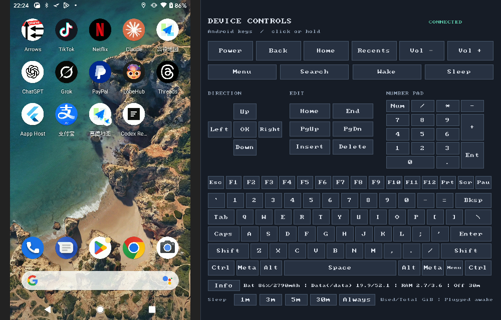

<!-- Copyright (C) 2026 moasm -->
<!-- SPDX-License-Identifier: Apache-2.0 -->
# scrcpy-controls

[English](README.md) | **简体中文**

[](https://github.com/django798/scrcpy-controls/actions/workflows/control-panel.yml)

基于 [Genymobile/scrcpy](https://github.com/Genymobile/scrcpy) **v5.0.1** 的非官方扩展版，
在投屏窗口右侧增加完整键盘、Android 按键和快捷设置。
维护者：moasm <moasm@sina.com>；沿用 Apache-2.0 许可证。

## 运行截图



以上为 **5.0.1-controls.2** 在 Windows 上连接 **Pixel 2（Android 11）** 的实机截图。
底部两排显示常驻说明 **`Used/Total GiB`（已用 / 总量）** 和 `Data(/data)` 分区标识。
这些数值是读取时的快照，在窗口启动和点击 **Info** 时刷新。

## 功能

- **同窗口控制面板**：完整 PC 键盘、Power、返回、Home、多任务、音量、方向键、
  编辑键、修饰键和长按重复。默认显示，`--no-control-panel` 可隐藏。
- **多设备同时投屏**：直接启动，为所有在线且已授权的 ADB 设备分别打开窗口；
  用 `-s SERIAL` 只选一台。Windows 监听端口与 ADB 转发在多实例之间隔离。
- **紧凑快捷设置**：读取电量、设备公开的电池容量、Data、RAM 和当前熄屏超时；
  可设 1、3、5、30 分钟或常亮。读回确认一致后才高亮设置。

## Windows 下载与运行

1. 下载并解压上游官方
   [scrcpy-win64-v5.0.1.zip](https://github.com/Genymobile/scrcpy/releases/download/v5.0.1/scrcpy-win64-v5.0.1.zip)。
2. 从 [本项目最新版本](https://github.com/django798/scrcpy-controls/releases/latest)
   下载 Windows x64 **客户端覆盖包**，解压到同一目录，覆盖 `scrcpy.exe`。
3. 启用设备的 USB 调试并授权当前电脑，运行 `run-controls.bat`。

```bat
run-controls.bat
run-controls.bat -s DEVICE_SERIAL --no-audio
run-controls.bat --no-control-panel
```

覆盖包只包含修改后的客户端与文档；ADB、运行库 DLL 和 Android 服务端来自匹配的
官方 **v5.0.1** 完整包。详见 [覆盖包安装说明](doc/windows-overlay.zh-CN.md)。

## 设备信息怎么看

第二排始终标明 **`Used/Total GiB`（已用 / 总量）**。例如：
`Data(/data) 19.9/52.1` 表示存储已用 19.9 GiB、总量 52.1 GiB；
`RAM 2.7/3.6` 表示内存已用 2.7 GiB、总量 3.6 GiB。左侧数值均不是剩余。

| 项目 | 统计来源与范围 |
| --- | --- |
| `Data(/data)` | `df -k /data` 的文件系统已用 / 总块数，包括应用数据及由该文件系统承载的用户文件。 |
| `RAM` | `/proc/meminfo` 中的 `(MemTotal − MemAvailable) / MemTotal`；可回收内存计入可用值，不是各进程 RSS 相加。 |
| 内置闪存（俗称 ROM） | 包含数据、系统、启动等分区的整机存储介质容量。与 `/data` 不同；本面板不从 Data 大小推测硬件容量，也不展示这个指标。 |

GiB 为 2³⁰ 字节，与设备标称容量使用的十进制 GB 不同；文件系统保留空间与配额
也会影响可分配空间。系统分区里的空闲不能直接加到应用可用空间。
Android 的 [StorageStatsManager](https://developer.android.com/reference/android/app/usage/StorageStatsManager)
同样区分存储介质的展示容量与卷的剩余空间；后者可能含可回收缓存，与 `df` 口径不同。

点击 **Info** 手动刷新，启动时也会自动读取。缺失数据显示 `--`。
只有设备公开满充或设计容量时才显示电池 mAh，不拿剩余电荷量估算电池容量。

超时设置在退出后保留。**Always** 使用 `2147483647 ms` 并启用外部供电时保持唤醒；
手动熄屏和厂商电源策略仍可生效。选回分钟档会关闭供电保持唤醒。
显式传入上游 `--stay-awake` 或 `--screen-off-timeout` 时，原有退出恢复机制仍适用。

## 从源码构建

Windows 需要 Python 3 和 PowerShell：

```powershell
powershell -ExecutionPolicy Bypass -File .\tools\build-windows.ps1
powershell -ExecutionPolicy Bypass -File .\tools\build-windows.ps1 -Configuration release
```

编译工具与校验过的依赖放在 Git 忽略的本地目录，完整本机运行目录为
`dist/scrcpy-controls-windows-x64`。公开版本使用上述客户端覆盖包分发。

Linux / macOS 按上游 [构建说明](doc/build.md)安装 SDL3、FFmpeg、libusb、Meson 和 Ninja：

```sh
meson setup build-controls --buildtype=debug -Dcompile_server=false
meson compile -C build-controls
meson test -C build-controls --print-errorlogs
curl -fL https://github.com/Genymobile/scrcpy/releases/download/v5.0.1/scrcpy-server-v5.0.1 -o scrcpy-server
SCRCPY_SERVER_PATH="$PWD/scrcpy-server" SCRCPY_ICON_DIR="$PWD/app/data" \
  ./build-controls/app/scrcpy
```

服务端 SHA-256：
`764eb6f79811d5211fe9df341120882ba9994c7a61b897d7bf3fb662e53bc536`。
Windows 已做真实设备验证；Linux、macOS Intel、Apple Silicon 原生 CI 构建并运行
17 项自动测试，设备交互尚待各平台实机验收。见 [构建与测试](https://github.com/django798/scrcpy-controls/actions/workflows/control-panel.yml)。

## 文档与反馈

- [完整操作说明与验收](doc/control-panel.md)
- [相对上游的变更记录](MODIFICATIONS.md)
- [本项目问题反馈](https://github.com/django798/scrcpy-controls/issues)
- 上游文档：[连接](doc/connection.md)、[视频](doc/video.md)、[音频](doc/audio.md)、
  [控制](doc/control.md)、[快捷键](doc/shortcuts.md)、[常见问题](FAQ.md)。
  上游安装包不包含本项目的控制面板。
- [支持上游维护者 rom1v](https://github.com/sponsors/rom1v)

## 许可证

沿用 [Apache-2.0](LICENSE)，保留原作者声明，见 [NOTICE](NOTICE) 与
[第三方许可及分发说明](THIRD_PARTY_NOTICES.md)。
本项目为个人维护的非官方 fork，未经 Genymobile 或 rom1v 背书。

原项目版权：Copyright (C) 2018 Genymobile；Copyright (C) 2018–2026 Romain Vimont。
本项目修改版权：Copyright (C) 2026 moasm。
